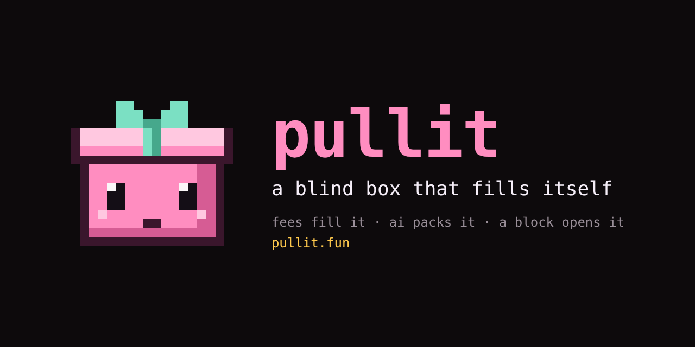
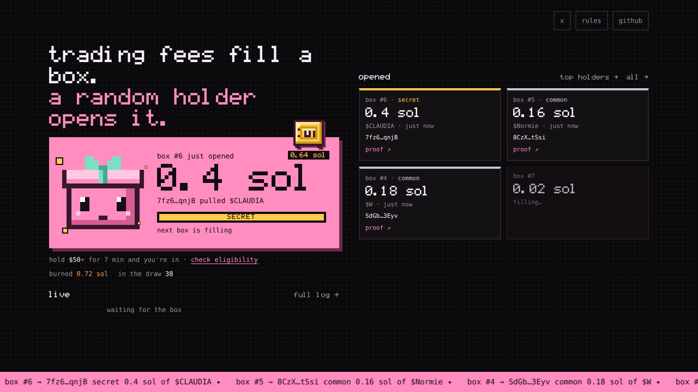
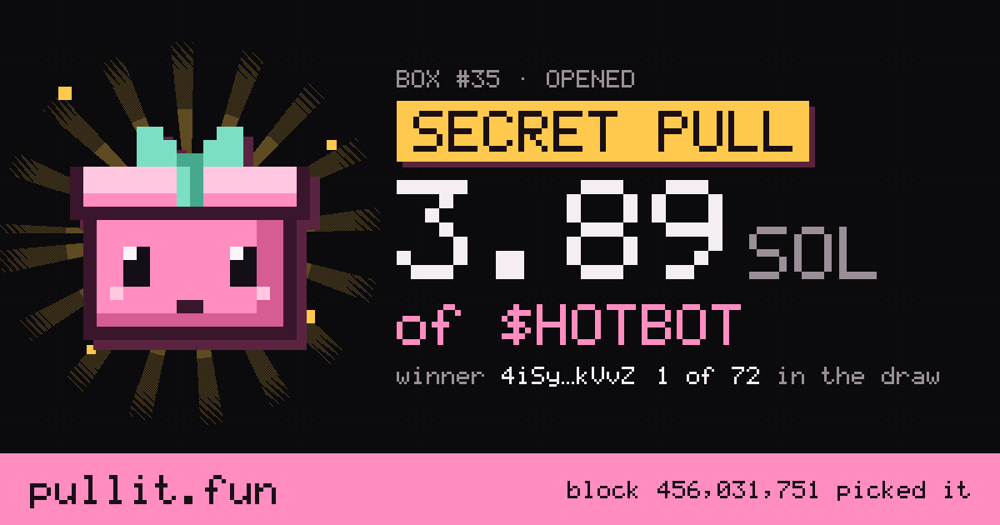

<p align="center"></p>

<p align="center">
  <a href="https://github.com/syanovee/pullit/actions/workflows/test.yml"></a>
  
  
  
</p>

<p align="center"><b>CA</b> <code>5Uycj5BUozB87WgocSPhFzGDvoUftvANadiWS4cKWLgG</code></p>

<p align="center">
  <a href="https://pump.fun/coin/5Uycj5BUozB87WgocSPhFzGDvoUftvANadiWS4cKWLgG">pump.fun</a> · <a href="https://pullit.fun">pullit.fun</a> · <a href="https://x.com/Pullitbox">@Pullitbox</a> · <a href="docs/architecture.md">architecture</a> · <a href="#check-a-box-yourself">check a box</a>
</p>

# pullit

Trading fees of $PULLIT fill a box. When it is full, an AI picks what goes inside and seals it.
A Solana block about 20 seconds in the future decides which holder opens it and what tier they pull.
Nobody knows the result in advance. Not the holders, not the AI, not us.

The bot can only buy. It buys the prize for the winner and buys $PULLIT to burn it. It has no code to sell anything.

## How it works

1. **Fees fill the box.** Every 15 seconds the bot claims the creator fees of $PULLIT. Until $PULLIT bonds, 75% goes to the box wallet and 25% stays in the dev wallet; while the market cap is under $10K, 20% goes to the box and 80% stays in the dev wallet; under $20K, 80% goes to the box and 20% stays in the dev wallet. After the bond, 70% goes to the box and 30% stays in the dev wallet (agent costs, servers, building). A small part of the box share is set aside in the vault.
2. **The AI packs it.** When the box is full, the agent scans the market, throws out anything that looks unsafe, and picks two coins: a fresh runner and a runner of the meta. It writes a joke about its picks on the site log, never the names.
3. **The box is sealed.** The bot publishes a seal: `sha256(common mint | rare mint | salt)`. The contents cannot change after that without the seal breaking.
4. **A future block decides.** The bot commits to a slot about 20 seconds ahead. When that block exists, its hash picks the winner (weighted by tickets) and the tier.
5. **The prize goes straight to the winner.** The bot swaps SOL from the box into the prize coin with Jupiter and delivers it to the winner's wallet in the same transaction. The seal and the draw are published so anyone can check them.
6. **Buyback and burn.** A tenth of every box buys $PULLIT and burns it. Each burn is a transaction on the site log.

Whatever a pull leaves in the box rolls into the next one.

<p align="center"></p>

### The box grows with the volume

The first box opens at 0.15 SOL. After that every box is sized from the fees of the last hour, so it fills in about 25 minutes: 0.15, 0.3, 0.5, 0.75, 1, 1.5, 2, 2.75, 3.5 up to 4 SOL. Busy market, bigger boxes. The entry grows with the box (see below).

### Every win gets a card

Each opened box has its own page, `pullit.fun/box/<n>`. Shared on X or Telegram it unfurls as the winner card, drawn by the worker itself:

<p align="center"></p>

## Boosts

- **Frenzy.** The more $PULLIT trades in an hour, the better the odds of the next box. Four levels, from epic 19.5% up to epic 34.5%. Secret is always 0.5%. The odds are locked into the box when it is sealed, so they are part of the public record.
- **Bond race.** Until $PULLIT bonds, 5% of every box goes into the bond pot. The last $50+ buy before the bond takes it, paid 7 minutes after the bond if that wallet still holds. The site shows how far the bonding curve is, and the bot posts at 50%, 75% and 90%.
- **Milestones.** The first box after the market cap crosses 50K, 100K, 250K, 500K, 1M, 2.5M, 5M or 10M is epic or better.
- **Bond box.** When $PULLIT bonds and moves to PumpSwap, whoever pulls the next box gets epic or better.
- **In the red.** A holder whose bag is worth less than the SOL they put in (buys minus sells, from their onchain history) gets 3x tickets until they are back up.
- **The clock.** Every buy of $50+ resets a 3 minute timer. When it hits zero, the last buyer takes the clock pot (20% of every box), if they still hold at least 90% of what they bought.
- **Lucky buys.** Every buy of $50+ is rolled against a block that did not exist when they bought: 1 in 15 takes half the lucky pot (10% of every box goes into it), paid 7 minutes later if they still hold.
- **Vault.** No longer filled: everything goes into the box. What is in it goes to a secret pull (0.5% per box), or into the final box if fees dry up.
- **It can only buy.** Every box buys $PULLIT and burns it. The bot has no code that sells anything: every swap starts from SOL, and a test fails if that ever changes (`test/executor.test.ts`).

All numbers live in [`src/boost.ts`](src/boost.ts).

## Who is in the draw

- hold $PULLIT for 7 minutes. no claiming, no buttons
- how much depends on the box: $20 for boxes up to 0.5 SOL, $50 up to 1.5, $75 above 1.5, $100 from 2.5, $250 from 5. a smaller bag keeps its hold time and joins again when a smaller box comes
- the longer you hold, the more tickets, up to 3x at 24 hours
- any sell puts your hold back to 1x. you stay in the draw
- check your chance on the site: it also shows what $50 more would do
- a bag counts up to 1% of supply, and no wallet can have more than 10% of all tickets
- pools, the bonding curve and our own wallets are never in the draw

## What the bot can and cannot do

The bot holds the keys of the dev wallet (to claim fees) and the box wallet (to pay prizes). The code that runs is the code in this repo, deployed to a Cloudflare Worker.

It can:

- claim creator fees and send them to the box: 75% until the bond (20% under $10K cap, 80% under $20K), 70% after (the other 30% stays in the dev wallet)
- swap box SOL into the prize coin and send it to the winner
- buy $PULLIT with box SOL and burn it
- post on x

It cannot:

- sell $PULLIT. every swap in the code goes from SOL to a token, never the other way
- send box funds anywhere except a draw winner or the burn
- pick a coin that the scanner did not list as safe. every AI answer goes through a validator in code, and a bad answer falls back to the top scored coins

## Check a box yourself

Every opened box can be recomputed from public data. The site has the check under each box ("check it myself"), or run it here (Node 22.6+):

```
npm install
npm run verify -- 12
```

This downloads box #12 from the site, checks the seal against the revealed coins, takes the blockhash of the committed slot, and recomputes the winner and the tier from the published ticket list.

How the draw works in detail: [docs/draw.md](docs/draw.md).

## Tested

```
npm install
npm run check
```

Formatting, strict types and 61 tests. One of them runs the real bot, not a dry run, against a simulated chain, Jupiter, PumpPortal and Helius, through hours of trading in fast forward. It checks every lamport: only claimed fees are split, every lamport of them reaches the box before the bond, SOL the dev adds itself is never touched, every box pays its winner once, buys back once and burns once, and a stale copy of the bot finds the payout on chain instead of paying again (`test/e2e.test.ts`).

## Docs

- [docs/architecture.md](docs/architecture.md): how it fits together, with diagrams
- [docs/draw.md](docs/draw.md): tickets, seed, winner, tier, seal
- [docs/agent.md](docs/agent.md): the market scanner, the AI, the validator
- [docs/fees.md](docs/fees.md): fee split, vault, rollover, final box
- [SECURITY.md](SECURITY.md): keys, wallets, what the code guarantees, reporting a problem
- [CHANGELOG.md](CHANGELOG.md): what changed

## Risks, plainly

- prizes are memecoins picked from the current market. they can go to zero
- the bot runs on Cloudflare and depends on Helius, Jupiter, OpenRouter and PumpPortal. if one is down, a box waits
- we control the keys. the code limits what the bot does, the keys could in theory be used by hand. every transaction of every wallet is public, so watch them
- not financial advice. its a box

## Map

```
src/loop.ts       the state machine: fill, pack, draw, pay, burn
src/executor.ts   blockhash randomness, prize sizes, seal, Jupiter swap, payout, burn
src/holders.ts    holder snapshots, tickets, the weighted pick
src/boost.ts      frenzy odds, market cap milestones, burn share
src/fees.ts       claim creator fees, 80/20 split, final box rule
src/scanner.ts    market scanner and safety filters (thresholds in src/config.ts)
src/agent.ts      the AI that packs the box, the validator, tier odds, its voice
src/solana.ts     keys, transactions and rpc, no dependencies
worker/           Cloudflare Worker: cron, api, site
scripts/verify.ts recompute any opened box
scripts/dev/       local tools: scanner, preview, test runs
test/             unit and end to end tests, run on every push
```
