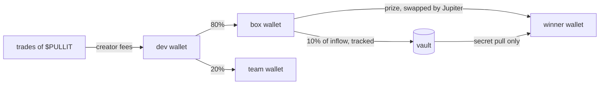
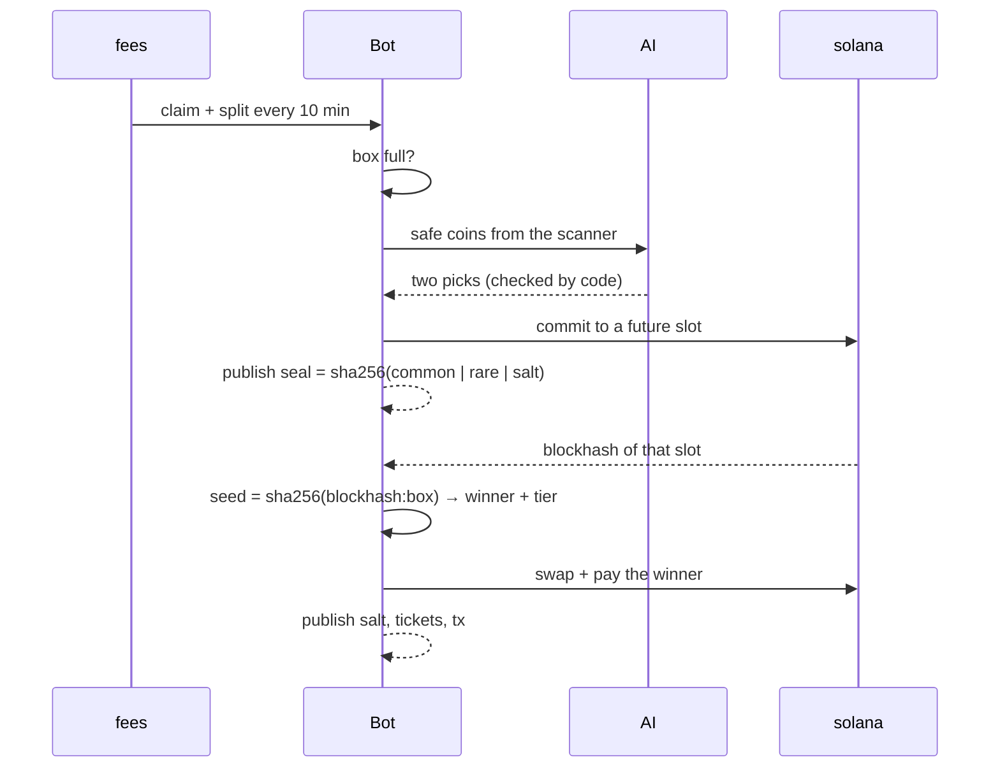

# Architecture

One Cloudflare Worker runs everything. A cron wakes it every minute, it does one step of the loop and saves its state in Cloudflare KV. There is no other server.

## Money

- the bot only ever sends box SOL to a draw winner, swapped into the prize coin in the same transaction
- the bot never trades or moves $PULLIT. it only reads balances to count tickets
- all three wallets are public. they are listed on the site

## One box, step by step

The seal is published before the block exists. The salt and the full ticket list are published after. Anyone can recompute the seal, the winner and the tier: `npm run verify -- <box>`, or "check it myself" on the site.

## Code

| file                | what it does                                                  |
| ------------------- | ------------------------------------------------------------- |
| `worker/index.ts`   | cron, public api, site                                        |
| `src/loop.ts`       | the state machine: fill, pack, draw, pay, roll over           |
| `src/fees.ts`       | claim creator fees, 80/20 split, final box rule               |
| `src/scanner.ts`    | market scanner and safety filters                             |
| `src/agent.ts`      | AI picks, the validator around them, tier odds, log lines     |
| `src/holders.ts`    | holder snapshots, tickets, weighted pick                      |
| `src/executor.ts`   | blockhash randomness, prize sizes, seal, Jupiter swap, payout |
| `scripts/verify.ts` | recompute any opened box from public data                     |

## What lives where

- **keys**: Cloudflare secrets only. never in this repo
- **state**: Cloudflare KV. current box, history, tickets of every opened box
- **outside services**: Helius (rpc, holders), Jupiter (prices, swaps), PumpPortal (fee claims), OpenRouter (AI), Zernio (posts on x). if one is down, the box waits
